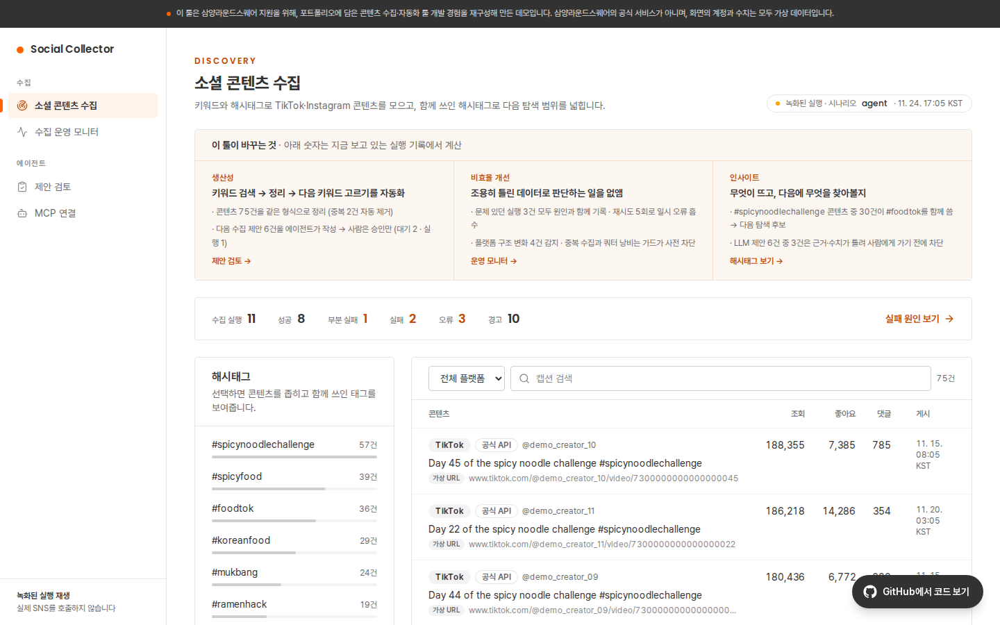
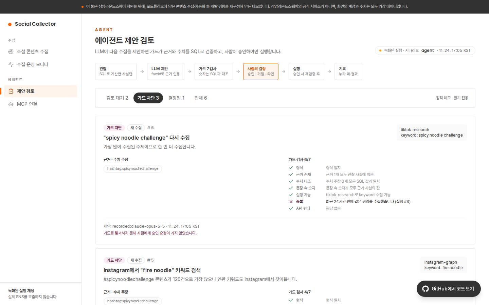
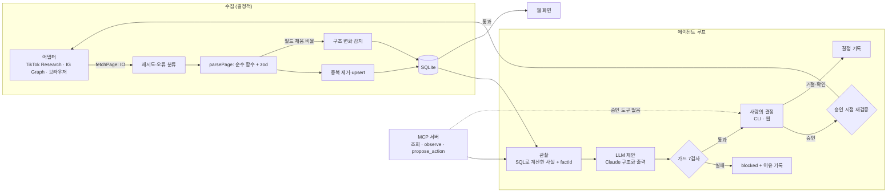

# Social Collector

**TikTok·Instagram에서 주제에 맞는 콘텐츠를 모으는 수집 에이전트입니다.** LLM이 다음에 무엇을 수집할지 제안하면, 결정적 가드가 그 근거와 숫자를 SQL로 검증합니다. 사람이 승인해야만 실행합니다. 수집 실패·누락·중복·플랫폼 변화는 조용히 넘기지 않고 기록하며, 수집 결과와 제안 기능은 MCP 도구로 AI에 공개합니다.

[](https://github.com/jjikkobro/marketing-tool-sy/actions/workflows/ci.yml) · **데모: https://jjikkobro.github.io/marketing-tool-sy/**

> 삼양라운드스퀘어 **Popow – AI Agent Builder** 지원을 위한 개인 포트폴리오입니다. 삼양라운드스퀘어의 공식 서비스가 아니며, 데모의 계정·게시물·수치는 모두 가상입니다.

---

## 0. 이 서비스의 목적과 효과

### 목적
브랜드 콘텐츠를 기획하는 사람이 **"지금 무엇이 뜨고 있고, 다음에 무엇을 찾아봐야 하는가"를 믿을 수 있는 데이터로 매일 얻게 하는 것**입니다.

여기서 "믿을 수 있다"는 세 가지를 뜻합니다.
- **수집**: 빠진 데이터가 있으면 빠졌다고 표시됩니다.
- **판단**: 숫자는 LLM이 아니라 SQL에서 나옵니다.
- **실행**: 사람이 승인한 것만 실행됩니다.

### 누가, 무엇을 덜 하게 되나

| | 지금까지 (수작업 또는 원본 툴) | Social Collector |
|---|---|---|
| **생산성** | 플랫폼마다 키워드를 검색하고, 결과를 스프레드시트에 옮기고, 다음 키워드를 감으로 고른다 | 수집, 정규화, 중복 제거가 자동이다. 함께 쓰인 해시태그에서 **다음 수집 후보를 에이전트가 근거와 함께 제안**하고, 사람은 승인 버튼만 누른다 |
| **비효율 개선** | 수집이 일부 실패해도 "성공"으로 보인다. 빈 데이터로 성과를 판단하고, 원인은 로그를 뒤져 찾는다. 같은 쿼리를 중복 수집해 API 쿼터를 낭비한다 | 실행마다 실패·재시도·누락·구조 변화가 **원인과 함께 기록**된다. 일시적 오류는 재시도로 흡수한다. 중복 수집과 쿼터 초과는 **가드가 실행 전에 막는다** |
| **인사이트** | "이 해시태그가 뜬다"는 말에 근거가 없거나, LLM이 그럴듯한 숫자를 지어낸다 | 해시태그 동시출현으로 **다음 탐색 키워드를 근거 수치와 함께** 보여준다. LLM이 쓴 숫자는 모두 SQL 값과 대조해 틀리면 사람에게 보내지 않는다 |

### 데모 실행 한 번으로 확인되는 결과
아래 수치는 `npm run demo:agent`(녹화된 가상 데이터)를 실행한 결과입니다. 실제 성과 수치가 아닙니다.

- **수집**: 콘텐츠 75건을 같은 형식으로 정리했고, 페이지 사이 중복 2건을 자동으로 제거했습니다.
- **실패 기록**: 문제가 있던 실행 3건이 모두 원인과 함께 남았습니다(요청 한도, 서버 오류 연속, 토큰 만료). 재시도 5회로 일시적 오류를 흡수했습니다.
- **구조 변화 감지**: 필드 소실, 필드명 변경, 마크업 변경을 모두 경고로 잡았습니다. 원본 툴이었다면 "성공"으로 지나갔을 상황입니다.
- **에이전트 제안**: 6건 중 3건을 차단했습니다(없는 근거, 부풀린 수치, 지원하지 않는 검색, 중복). 나머지 3건만 사람에게 갔고, 승인된 1건이 실제 수집으로 이어졌습니다.
- **다음 탐색 키워드**: "#spicynoodlechallenge 콘텐츠 중 30건이 #foodtok을 함께 씀"처럼 근거 수치를 붙여 보여줍니다.

툴 첫 화면 상단의 **"이 툴이 바꾸는 것"** 패널이 지금 보고 있는 실행 기록에서 이 수치를 계산해 보여줍니다.

---

## 빠르게 확인하기

```bash
git clone https://github.com/jjikkobro/marketing-tool-sy && cd marketing-tool-sy
npm install
npm run demo:agent   # API 키 없이 실행: 수집 → 실패 재현 → LLM 제안 → 가드 → 승인 대기
```

```
#  상태        종류             제목                                     가드
1  실행 완료   collect_query    #asmr 해시태그를 TikTok에서 직접 수집    ✓ 7/7
2  검토 대기   retry_run        부분 실패한 실행 #4 다시 수집            ✓ 7/7
3  검토 대기   operator_action  Instagram 액세스 토큰 갱신 필요          ✓ 7/7
4  차단(가드)  collect_query    #spicyramen 급상승, Instagram에서 수집   ✗ evidence ✗ claims ✗ grounded_numbers
5  차단(가드)  collect_query    Instagram에서 "fire noodle" 키워드 검색  ✗ claims ✗ grounded_numbers ✗ capability
6  차단(가드)  collect_query    "spicy noodle challenge" 다시 수집       ✗ duplicate

  #5 차단 사유
    - claims: hashtag:spicynoodlechallenge.contents: 주장 120, 실제 57
    - grounded_numbers: 근거에 없는 숫자: 120
    - capability: instagram-graph는 keyword 검색을 지원하지 않습니다 (지원: hashtag)
```

```bash
npm run agent -- approve 2 --reviewer <이름> --note "503은 일시 오류라 재시도"   # 사람이 승인 → 재검증 → 실행
npm run dev:live    # 웹 화면에서 승인·거절 (로컬 검토 API + 웹)
```

| 소셜 콘텐츠 수집 | 에이전트 제안 검토 | 수집 운영 모니터 |
|---|---|---|
|  |  |  |

---

## 목차
1. [해결하려던 문제](#1-해결하려던-문제)
2. [동작 구조와 선택 이유](#2-동작-구조와-선택-이유) (AI 제안 검토 포함)
3. [실제 실행에서 잘 된 점과 문제점](#3-실제-실행에서-잘-된-점과-문제점)
4. [해결 방법과 확인 방법](#4-해결-방법과-확인-방법)
5. [실행 방법과 배포](#5-실행-방법과-배포)
6. [수집 경계와 한계](#6-수집-경계와-한계)

---

## 1. 해결하려던 문제

이전 직장에서 마케팅 콘텐츠 자동화 툴을 직접 만들고 운영했습니다. 하는 일은 SNS 소재 수집, 게시물 성과 추적, 콘텐츠 생성이었습니다(Node.js, Express, Prisma, React). 운영하면서 가장 오래 남은 문제는 생성이 아니라 **수집이 조용히 틀리는 것**이었습니다.

- **미수집 값이 0으로 저장됨.** 좋아요와 댓글을 받지 못해도 반응 합계가 `0`이 되어, 데이터가 없던 게시물이 "반응 없음"으로 판정됐습니다.
- **식별자가 없는 항목이 하나로 합쳐짐.** 중복 판별 키의 두 번째 폴백이 항상 참이라, URL과 ID가 없는 서로 다른 글이 하나만 남았습니다.
- **같은 게시물이 두 번 저장됨.** Instagram의 `/p/X`와 `/reel/X`를 다른 콘텐츠로 셌습니다.
- **잘린 줄 모름, 원인을 알 수 없음.** 페이지 상한에 닿으면 남은 결과를 기록 없이 버렸습니다. 재시도가 없었고, 실패는 문자열 한 줄로만 남았습니다.

그리고 LLM으로 "다음 소재"를 고르게 하면, **그럴듯하지만 데이터에 없는 숫자**가 섞여 나왔습니다.

이 저장소는 원본의 수집·추적 부분을 TypeScript로 다시 설계했고, 그 위에 **"LLM은 제안만, 숫자는 SQL이, 결정은 사람이"** 하는 에이전트 루프를 얹었습니다. 원본 버그 3건은 원본 동작을 재현하는 테스트와 수정 후 동작을 검증하는 테스트를 나란히 두었습니다([`legacy-regressions.test.ts`](apps/collector/test/legacy-regressions.test.ts)).

## 2. 동작 구조와 선택 이유



### 에이전트: LLM 제안 → 할루시네이션 방지 → 사람의 확인

| 단계 | 어떻게 | 왜 |
|---|---|---|
| 관찰 | DB에서 사실 목록을 만든다. 예: `hashtag:asmr {contents: 18}`, `run:4 {lastHttpStatus: 503}` | LLM이 인용할 수 있는 것을 "SQL로 계산한 사실"로 한정하기 위해서다 |
| 제안 | Claude가 구조화 출력으로 제안한다(`betaZodOutputFormat`). 근거는 `factId`로만 인용하고, 숫자는 `claims`에 따로 적는다 | 자유 문장에 섞인 숫자는 검증할 수 없다. 숫자를 데이터와 대조할 수 있는 형태로 꺼내게 한다 |
| 가드 | 7개 검사를 결정적으로 수행한다 (아래 목록) | 프롬프트 지시는 확률을 낮출 뿐 보장하지 않는다. 대조는 기계가 한다 |
| 사람 | 승인, 거절(사유 필수), 확인(운영 조치). 검토자 이름은 필수다 | 수집은 쿼터와 약관이 걸린 외부 호출이다. 실행 직전에 사람이 확인할 지점이 있어야 한다 |
| 실행 | 승인하는 순간 가드를 다시 돌린다 | 제안 이후 같은 쿼리가 수집됐거나 쿼터가 찼을 수 있다(TOCTOU) |
| 기록 | 제안, 가드 결과, 검토자, 사유, 결과 실행 번호를 한 행에 남긴다. DB CHECK 제약이 사유 없는 거절과 검토자 없는 결정을 막는다 | "누가 무엇을 근거로 무엇을 실행했는가"를 추적하기 위해서다 |

가드의 7개 검사는 다음과 같습니다.
- **schema**: 형식이 맞는가
- **evidence**: 인용한 근거가 관찰 목록에 있는가
- **claims**: 수치 주장이 SQL 값과 같은가
- **grounded_numbers**: 문장 속 숫자가 근거 사실의 값인가
- **capability**: 그 어댑터로 실행할 수 있는가
- **duplicate**: 같은 제안이나 최근 수집과 겹치지 않는가
- **quota**: API 한도를 넘지 않는가

MCP에는 `observe`(사실 목록)와 `propose_action`(제안)까지만 열었습니다. 그래서 Claude Code 같은 외부 AI도 계획자가 될 수 있지만 **승인 도구는 없습니다**. 실제 MCP 클라이언트로 확인한 결과는 이렇습니다. 정확히 인용한 제안은 `pending`이 됐고, 숫자를 10에서 500으로 부풀린 제안은 `blocked`와 이유가 돌아왔습니다. 이 루프를 Managed Agents처럼 모델이 도구 호출을 이어가는 방식으로 만들지 않은 이유는 [0003](docs/decisions/0003-에이전트-루프와-사람의-확인.md)에 있습니다.

### 수집: 선택과 고려했지만 넣지 않은 것

| 선택 | 이유 | 넣지 않은 것 |
|---|---|---|
| fetch와 parse 분리 | 파싱을 순수 함수로 두면 녹화한 응답만으로 모든 분기를 테스트할 수 있다 | — |
| 중복 키 `UNIQUE(platform, platform_content_id)` | URL 해시는 URL 형식이 바뀌면 깨진다(원본의 `/p`·`/reel` 문제) | 제목·본문 해시 폴백 (다른 글을 지울 수 있다) |
| 실패를 행으로 남김 | 단계, 종류, HTTP 상태, 시도 횟수로 집계할 수 있어야 원인을 찾는다 | 원시 페이지 보관 (저장할 개인정보만 늘어난다) |
| 429·5xx는 재시도, 401은 즉시 실패 | 인증 오류는 재시도해도 쿼터만 쓴다. Retry-After를 우선하고, 없으면 full-jitter 백오프 | — |
| 구조 변화를 필드 채움 비율로 감지 | 원본은 필드명이 바뀌면 조용히 null로 흡수했다 | 필드별 스키마 스냅샷 테이블 |
| SQLite + 직접 쓴 SQL | 집계·동시출현 쿼리를 그대로 보여주고 설명할 수 있다 | Prisma(원본), Drizzle |
| 워크스페이스 2개 | CLI, MCP, 검토 API는 같은 `queries/`를 쓰는 진입점 파일일 뿐이다 | 공유 타입 패키지 (subpath export로 대체) |

### AI 코딩 에이전트의 제안을 어떻게 검토했는지

Claude Code로 개발했고, 방향을 정할 때는 **관점이 다른 AI 에이전트 4개(면접관·아키텍트·전략가·레드팀)에게 두 라운드 토론**을 시켰습니다. 결론은 제가 정했고, 제안마다 채택·수정·기각과 근거를 [결정 기록](docs/decisions/)에 남겼습니다. 기각한 예는 다음과 같습니다.

- **TikTok oEmbed 7일 실데이터 점검**: 문서와 개발자 약관 원문을 직접 읽고 기각했습니다. 응답에 필요한 필드가 없었고, 약관 III.3(h)가 콘텐츠 레코드 구축을 금지했으며, 기능 자체가 폐기 예정이었습니다.
- **YouTube Data API 실수집**: 대상 플랫폼이 아니어서 기각했습니다.
- **Drizzle 전환, lease 락**: 이 규모에서 설명할 수 없는 복잡도라 기각했습니다.
- **"HTTP 서버를 두지 않는다"**: 처음의 결정이었지만 사람의 확인 화면이 필요해져 **스스로 뒤집었습니다**([0003](docs/decisions/0003-에이전트-루프와-사람의-확인.md)).

## 3. 실제 실행에서 잘 된 점과 문제점

**잘 된 점**
- `npm run demo:agent` 한 번으로 다음을 모두 확인할 수 있습니다.
  - 수집 실패 7가지가 원인과 함께 기록됩니다.
  - LLM 할루시네이션 3가지가 차단됩니다.
  - 사람의 승인 대기열이 만들어집니다.
- 웹 화면에서 승인 버튼을 누르면 재검증을 거쳐 실제 수집 실행으로 이어지고, 검토자가 기록됩니다(Playwright로 확인).
- 같은 쿼리를 다시 돌리면 새 행 0, 갱신 14입니다(멱등성).
- 실제 Chromium으로 가상 피드를 수집해 두 종류의 마크업 변화를 구분했습니다.
  - 클래스 이름 변경: "수집 성공, 조회수 채움 비율 100% → 0%"
  - 구조 개편: "블록 8개, 셀렉터 0건"

**실행하고서야 드러난 문제** (모두 고쳤고 회귀 테스트가 있습니다. [0002](docs/decisions/0002-실행에서-발견한-문제.md))

| 문제 | 원인 |
|---|---|
| 좋아요를 숨긴 Instagram 게시물이 **통째로 버려짐** | zod v4에서 `z.unknown()`도 키가 없으면 실패한다. "0 대신 null"을 고치다 "아예 버리는" 버그를 만들었다 |
| TikTok 영상 ID가 **다른 값으로 바뀜** | `JSON.parse`가 2^53을 넘는 int64를 double로 바꾼다(공식 문서 예시 ID가 해당). 파싱 전에 문자열로 감싼다 |
| 어댑터별 **오류 집계가 틀림** | `json_group_object`에 같은 키가 여러 번 들어가 마지막 값만 남았다 |
| 브라우저 수집이 **전부 실패** | tsx(esbuild)의 `__name` 헬퍼가 `page.evaluate`로 직렬화된 코드에 없다 |
| 예외가 나면 **다음 실행이 영구히 막힘** | `running`으로 남은 실행을 부분 UNIQUE 인덱스가 계속 막는다 |
| 데모 링크가 **열리지 않음** | 가상 URL을 클릭할 수 있는 링크로 보여줬다. 녹화 데이터에서는 "가상 URL"로 표시하고 링크를 걸지 않는다 |

## 4. 해결 방법과 확인 방법

| 확인 | 명령 | 내용 |
|---|---|---|
| 테스트 58개 | `npm test` | 원본 버그 회귀, 재시도·오류 분류, 파싱, 파이프라인, 실제 Chromium 수집, **가드 할루시네이션 차단과 사람의 확인 구조 18개** |
| 테스트가 버그를 잡는지 | 고친 코드를 되돌려 실행 | 수집 쪽 3곳을 되돌리면 13개, 가드 수치 대조와 승인 시점 재검증을 끄면 각각 해당 테스트가 실패한다 |
| 데모 재현 | `npm run demo:agent` | 위 출력이 그대로 나온다 |
| 공개 안전 | `npm run check:leaks` | 이전 직장 명칭이 저장소에 들어가지 않았는지 해시로 검사한다 |
| CI | GitHub Actions | 위 항목과 타입 검사, 린트, 포맷, 빌드를 push마다 실행한다 |

픽스처는 응답 구조를 [TikTok Research API](https://developers.tiktok.com/doc/research-api-specs-query-videos)와 [Instagram Graph API](https://developers.facebook.com/docs/instagram-platform/instagram-graph-api/reference/ig-hashtag/recent-media) 문서 예시에서 가져오고, 값만 가상으로 채웠습니다.

## 5. 실행 방법과 배포

Node 22 이상이 필요합니다.

```bash
npm install
npm run demo:agent          # 수집 + 실패 시나리오 + 에이전트 제안
npm run agent -- list       # 제안과 가드 결과
npm run agent -- plan --planner claude   # Claude API로 실제 계획 (ANTHROPIC_API_KEY 필요)
npm run dev:live            # 로컬 검토 API + 웹. 화면에서 승인·거절
npm run dev                 # 웹만 (정적 스냅샷, 읽기 전용)
npm run snapshot            # 웹 화면용 스냅샷 다시 만들기
```

**MCP 연결** (데모를 한 번 실행한 뒤)

```bash
claude mcp add social-collector -- npx tsx apps/collector/src/mcp.ts
```

도구는 조회 5개(`search_contents` 등), `observe`, `propose_action`, `list_proposals`입니다. 승인 도구는 없습니다.

**배포**: `main`에 push하면 GitHub Actions가 웹을 GitHub Pages에 올립니다(`.github/workflows/pages.yml`). 정적 배포라서 제안 검토 화면은 읽기 전용이고, 승인은 로컬 검토 모드에서만 할 수 있습니다.

## 6. 수집 경계와 한계

**하지 않는 것**
- 로그인이 필요한 페이지 수집
- 차단 우회
- 실제 SNS 사이트 스크래핑 (브라우저 자동화는 저장소 안의 가상 피드만 대상으로 합니다)

**한계**
- 실서비스 API 호출과 Claude 계획자 호출은 이 환경에 키가 없어 검증하지 못했습니다. 요청 형식은 공식 문서와 SDK 타입을 따랐고, 모든 데모는 녹화한 응답으로 돕니다.
- 가드는 "근거와 숫자가 데이터와 맞는가"를 보장하지만, "좋은 제안인가"는 판단하지 않습니다. 그 판단은 사람의 몫입니다. "열두 건"처럼 한글로 쓴 숫자는 잡지 못합니다.
- 플랫폼 한도가 있습니다.
  - TikTok Research API는 승인된 연구 목적에만 열려 있고, 하루 1,000회까지 요청할 수 있습니다.
  - Instagram 해시태그 조회는 7일 동안 고유 해시태그 30개, 최근 24시간 게시물로 제한됩니다. 이 한도는 가드가 미리 검사합니다.
- 구조 변화 감지는 필드 채움 비율만 봅니다. 값의 의미가 바뀌는 경우는 잡지 못합니다.

---

<sub>디자인 톤은 삼양라운드스퀘어 CI의 컬러 규정(Evolving Orange #FF6400, Sophisto Charcoal #323232 등)과 서체(Pretendard, Poppins)만 참고했으며, CI 심볼과 로고는 사용하지 않았습니다.</sub>
