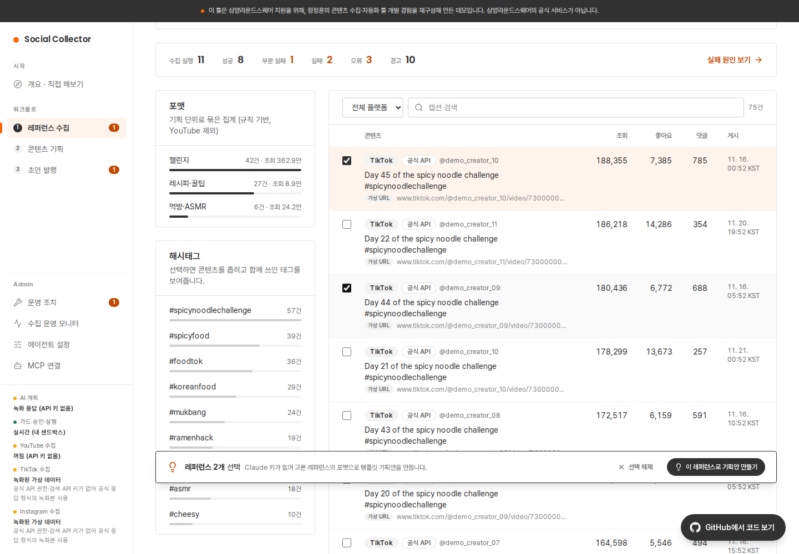
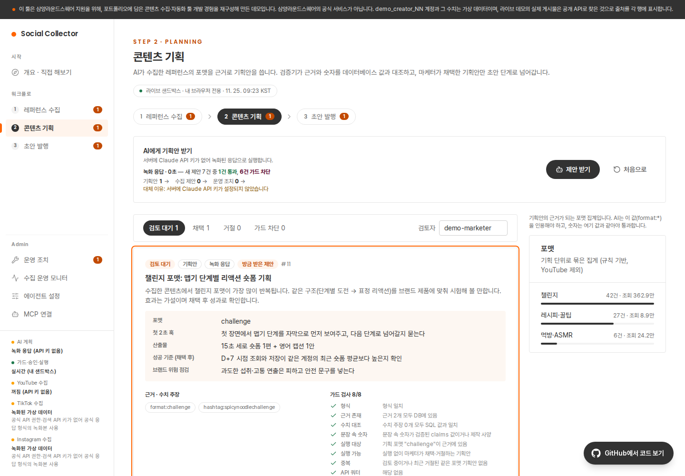
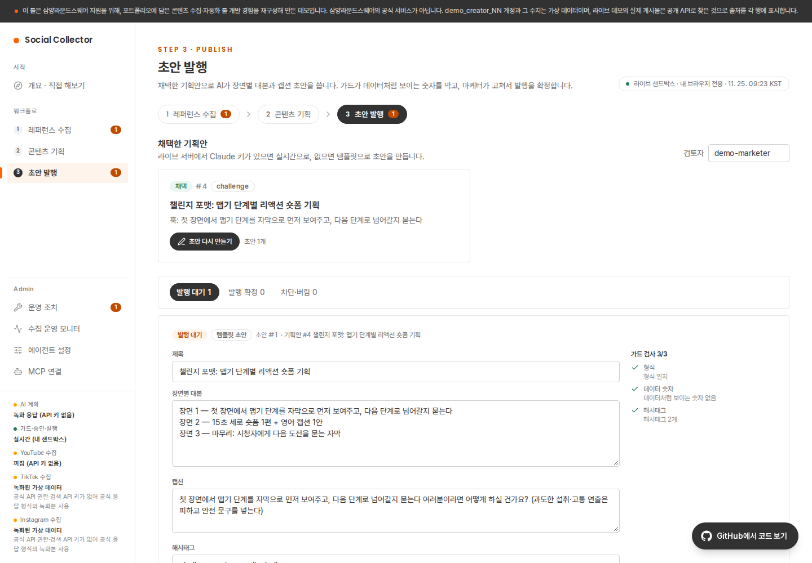
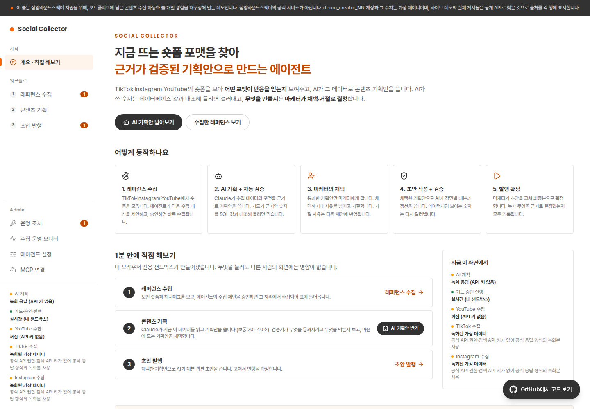
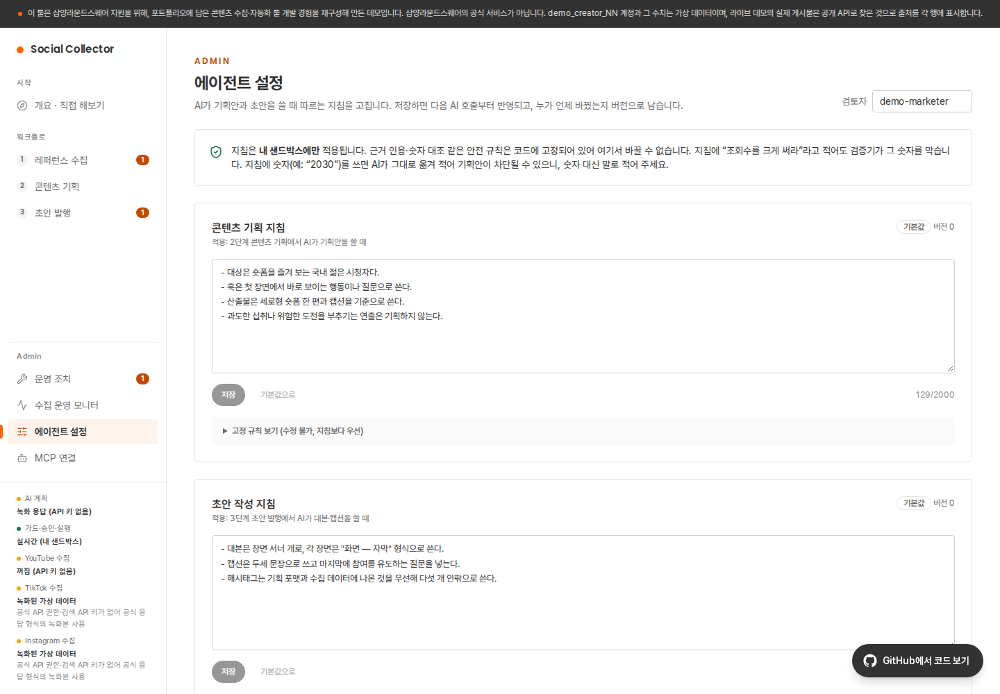
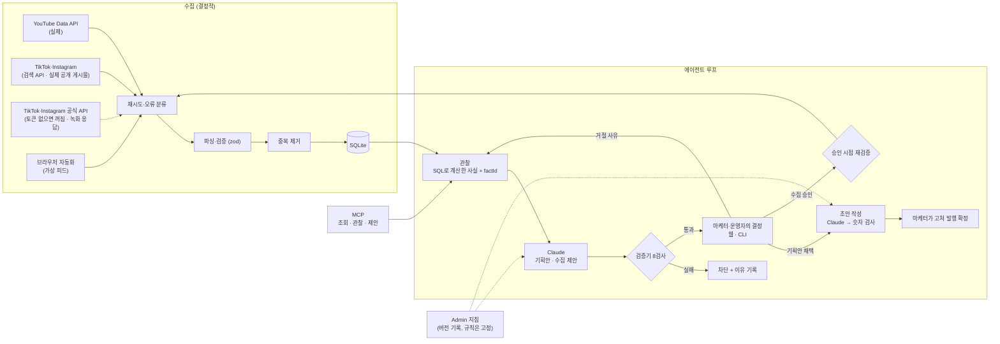

# Social Collector

**지금 뜨는 숏폼 포맷을 찾아, 근거가 검증된 콘텐츠 기획안으로 만드는 AI 에이전트입니다. 무엇을 만들지는 마케터가 고릅니다.**

- **무엇을**: YouTube·TikTok·Instagram의 숏폼을 모아 어떤 포맷(챌린지, 레시피, 먹방·ASMR…)이 반응을 얻는지 보여주고, Claude가 그 데이터로 기획안을 씁니다.
- **왜**: 이전 직장에서 마케팅 콘텐츠 자동화 툴을 직접 만들어 운영했습니다. 가장 오래 괴롭힌 문제는 생성이 아니라 **수집이 조용히 틀리는 것**과 **AI가 그럴듯한 숫자를 지어내는 것**이었습니다.
- **무엇이 다른가**: AI가 쓴 숫자는 데이터베이스 값과 대조해 틀리면 사람에게 보내지 않습니다. 실행은 사람이 승인할 때만 일어납니다.

[](https://github.com/jjikkobro/marketing-tool-sy/actions/workflows/ci.yml) [](https://render.com/deploy?repo=https://github.com/jjikkobro/marketing-tool-sy)

> 삼양라운드스퀘어 **Popow – AI Agent Builder** 지원을 위한 개인 포트폴리오입니다. 삼양라운드스퀘어의 공식 서비스가 아닙니다. 키가 설정된 라이브 데모에서는 YouTube(Data API)와 TikTok·Instagram(검색 API로 찾은 공개 게시물)이 실제 데이터입니다. 키가 없거나 정적 스냅샷이면 TikTok·Instagram은 `demo_creator_NN` 형식의 가상 데이터입니다.

**마케터의 워크플로**: ① 레퍼런스 수집 → ② 콘텐츠 기획 → ③ 초안 발행. 운영 조치·수집 모니터·에이전트 설정은 사이드바 아래 Admin에 따로 있습니다.

| ① 레퍼런스 수집 | ② 콘텐츠 기획 | ③ 초안 발행 |
|---|---|---|
|  |  |  |
| 에이전트의 수집 제안을 승인하면 그 자리에서 수집되고 새 콘텐츠가 표에 표시됩니다. 레퍼런스를 골라 **이 레퍼런스로 기획안 만들기**로 2단계에 바로 넘길 수 있습니다 | AI가 포맷 집계를 근거로 기획안을 쓰고, 검증기 8검사를 통과한 것만 마케터가 채택합니다 | 채택한 기획안으로 AI가 대본·캡션을 쓰고, 마케터가 고쳐 발행을 확정합니다 (실제 SNS 게시는 하지 않음) |

| 개요 · 직접 해보기 | Admin · 에이전트 설정 |
|---|---|
|  |  |
| | 기획·초안 지침을 화면에서 고치고 버전으로 남깁니다. 근거·숫자 규칙은 코드에 고정되어 지침으로 풀 수 없습니다 |

---

## 0. 이 서비스로 무엇이 달라지나

| | 지금까지 | Social Collector |
|---|---|---|
| **생산성** | 플랫폼마다 검색하고, 결과를 시트에 옮기고, 다음에 무엇을 만들지 감으로 정하고, 대본을 처음부터 쓴다 | 수집·정리·포맷 분류는 자동이다. AI가 근거를 붙여 기획안과 초안을 쓰면 마케터는 **채택하고 고쳐서 확정**한다 |
| **비효율 개선** | 수집이 일부 실패해도 "성공"으로 보이고, 빈 데이터로 판단한다. 같은 쿼리를 중복 수집해 API 한도를 낭비한다 | 실패·재시도·누락·플랫폼 구조 변화가 **원인과 함께 기록**된다. 중복 수집과 한도 초과는 **실행 전에 막는다** |
| **인사이트** | "이게 뜬다"에 근거가 없거나, AI가 숫자를 지어낸다 | 포맷별 반응과 함께 쓰인 해시태그를 근거 수치와 함께 보여준다. **AI의 숫자는 데이터와 맞을 때만** 사람에게 간다 |

효과를 무엇으로 측정할지도 정해 두었습니다. 가상 데이터로 효과 수치(%)를 만들지는 않습니다.
- **기획 리드타임**: 수집에서 채택까지 걸린 시간
- **기획안 채택률과 거절 사유**: 다음 AI 기획에 반영된다
- **채택안의 D+7 성과**: 이전 직장에서 운영하던 D+3/D+7 판정을 그대로 가져왔다

**누가 무엇을 쓰나**
- **마케터**: 웹 화면을 씁니다. 설치할 것이 없습니다.
- **엔지니어와 AI 도구(Claude Code 등)**: MCP를 씁니다. 같은 데이터를 조회하고 제안까지 할 수 있지만, **승인 도구는 없어서** 결정은 항상 사람이 웹에서 합니다.

---

## 1. 해결하려던 문제

이전 직장(취업 서비스)에서 SNS 소재 수집, 게시물 성과 추적, 콘텐츠 생성을 하는 마케팅 툴을 직접 만들어 운영했습니다(Node.js, Express, Prisma, React). 운영하면서 이런 일이 반복됐습니다.

- **수집하지 못한 값이 0으로 저장됐습니다.** 좋아요·댓글을 받지 못한 게시물이 "반응 없음"으로 판정됐고, 그 판정이 다음 소재 결정에 쓰였습니다.
- **식별자 없는 글이 하나로 합쳐졌고, 같은 게시물이 두 번 저장됐습니다.** 원인은 중복 판별 키의 폴백 버그, 그리고 Instagram의 `/p/`와 `/reel/` 주소 차이였습니다.
- **페이지 상한에서 잘린 줄 몰랐고, 실패 원인을 매번 로그에서 뒤졌습니다.**
- **LLM에게 다음 소재를 고르게 하면 데이터에 없는 숫자가 섞여 나왔습니다.**

이 저장소는 원본의 수집·추적 부분을 TypeScript로 다시 설계하고, 그 위에 **"AI는 제안만, 숫자는 데이터베이스가, 결정은 사람이"** 하는 에이전트 루프를 얹은 것입니다. 원본 버그 3건은 원본 동작을 재현하는 테스트와 수정 후 테스트를 나란히 두었습니다([`legacy-regressions.test.ts`](apps/collector/test/legacy-regressions.test.ts)).

## 2. 동작 구조와 선택 이유



### 할루시네이션을 막는 방법 (검증기 8검사)
AI는 데이터의 사실을 ID(`factId`)로만 인용하고, 숫자는 `claims`에 따로 적습니다. 검증기는 다음을 검사합니다.

1. **근거 존재**: 인용한 사실이 DB에 있는가
2. **수치 대조**: claims의 숫자가 SQL 값과 정확히 같은가
3. **문장 속 숫자**: 제목·근거 문장의 숫자가 claims 값인가. 단위 변환(만·배·%), 한글 수사, 전각 숫자도 막는다
4. **실행 대상**: 제목과 실제 실행 대상이 근거와 일치하는가
5. **실행 가능**: 그 플랫폼 API로 할 수 있는 일인가
6. **중복**: 검토 중인 같은 제안, 최근 수집, 사람이 7일 안에 거절한 대상과 겹치지 않는가
7. **API 쿼터**: 하루 한도를 넘지 않는가
8. **형식**

이 설계를 독립된 레드팀 에이전트에게 공격하게 했습니다. 우회 12건과 CSRF가 재현됐고, 모두 막은 뒤 회귀 테스트로 남겼습니다([0004](docs/decisions/0004-레드팀-검토와-대응.md)).

### 주요 선택과 버린 것

| 선택 | 이유 |
|---|---|
| 실패를 행으로 남긴다 (단계·종류·HTTP 상태·시도 횟수) | 원인을 집계해야 고칠 수 있다. 원본은 문자열 한 줄이었다 |
| 429·5xx는 재시도, 401·쿼터 소진은 즉시 중단 | 재시도해도 나아지지 않는 오류에 쿼터를 쓰지 않는다 |
| 플랫폼 구조 변화를 "필드 채움 비율"로 감지 | 원본은 필드명이 바뀌면 조용히 null로 흡수했다 |
| 포맷은 LLM이 아닌 공개 규칙으로 분류 | 같은 입력에 같은 결과가 나와야 설명할 수 있다 |
| SQLite + 직접 쓴 SQL, 워크스페이스 2개 | 이 규모에서 설명할 수 없는 구조(ORM 전환, 락 테이블)는 넣지 않았다 |
| 기획안은 채택해도 실행하지 않는다 | 기획은 사람이 만들 것을 고르는 일이고, 수집은 쿼터·약관이 걸린 실행이라 경계를 나눴다 |
| 화면을 마케터 워크플로(수집 → 기획 → 초안)와 Admin으로 나눴다 | 한 화면에 수집 제안·기획안·운영 조치가 섞여 헷갈린다는 피드백. 같은 AI 호출 결과를 종류별로 해당 단계에 보낸다 ([0007](docs/decisions/0007-워크플로-화면과-동적-지침.md)) |
| 지침은 화면에서 고치고, 근거·숫자 규칙은 코드에 고정 | 톤·타깃은 마케터가 정할 일이지만, 지침으로 검증을 풀 수 있으면 가드가 의미가 없다 |
| 초안 "발행"은 최종본 확정까지만 | 사람의 승인 없이 외부로 나가는 경로를 만들지 않는다. 실제 게시는 플랫폼 계정·약관이 걸린 별도 결정이다 |

### AI 코딩 에이전트의 제안을 어떻게 검토했는지
Claude Code로 개발했습니다. 방향을 정할 때는 관점이 다른 AI 에이전트들을 서로 토론시켰습니다.
- **범위**: 면접관·아키텍트·전략가·레드팀 4명이 2라운드 토론했습니다([0001](docs/decisions/0001-포트폴리오-범위.md)).
- **전략**: 마케터·인사·AX·사업전략·컨설턴트 5명 × 전략 6개로 시뮬레이션 30회를 돌렸습니다([0005](docs/decisions/0005-라이브-데모와-기획안-층.md)).

결론은 제가 정했고, 에이전트의 주장은 1차 자료로 확인했습니다.
- "TikTok oEmbed로 실데이터 점검" → 약관 III.3(h) 원문을 확인하고 **기각**했습니다.
- "YouTube 검색은 100단위" → 문서상 지금은 하루 100회 별도 버킷이었습니다. **고쳐서 반영**했습니다.
- "HTTP 서버는 두지 않는다"는 처음 결정 → 사람의 확인 화면이 필요해져 **스스로 뒤집었습니다**([0003](docs/decisions/0003-에이전트-루프와-사람의-확인.md)).

## 3. 실제 실행에서 잘 된 점과 문제점

**잘 된 점**
- 실제 Claude(claude-opus-5-5) 호출 한 번에 20초 안팎으로 기획안과 수집 제안이 나옵니다.
- 마지막 실행에서는 4건이 모두 검증을 통과했고, 그중 기획안 1건을 마케터가 채택했습니다.
- 녹화 응답에 넣어 둔 할루시네이션 3건(없는 근거, 57건 → 120건 부풀림, 중복)은 모두 차단됩니다.
- 실패 7가지(429, 503 연속, 토큰 만료, 필드명 변경, 페이지 상한, 필드 소실, 마크업 변경)가 원인과 함께 기록됩니다.

**실제로 돌려 보고서야 드러난 문제** ([0002](docs/decisions/0002-실행에서-발견한-문제.md), 모두 회귀 테스트 있음)

| 문제 | 원인 → 수정 |
|---|---|
| 좋아요를 숨긴 게시물이 통째로 버려짐 | zod v4는 키가 없으면 실패한다 → 지표 필드를 optional로 |
| TikTok 영상 ID가 다른 값으로 바뀜 | `JSON.parse`가 int64 정밀도를 잃는다 → 파싱 전에 문자열로 |
| 실제 Claude가 기획안에 `collect_query`를 붙여 차단됨 | 한 배열에 종류를 섞어 받았다 → **출력 칸을 기획안과 실행 제안으로 나눔** |
| 좋은 기획안이 "첫 2초"·"1인분" 때문에 차단됨 | 사양 숫자도 데이터 주장으로 봤다(첫 2초는 내 프롬프트가 유도) → 사양 칸은 "데이터처럼 보이는 숫자"만 막도록 원칙 변경 |
| 61건이 모두 "챌린지"로 분류됨 | 캡션 속 `#spicynoodlechallenge`(주제)를 포맷으로 읽었다 → 해시태그를 빼고 캡션 먼저 판단 |

## 4. 해결 방법과 확인 방법

| 확인 | 내용 |
|---|---|
| `npm test` (100개 이상) | 원본 버그 회귀, 재시도·오류 분류, 실제 Chromium 수집, 검증기, 레드팀 우회 회귀, 실제 Claude 출력 회귀, YouTube 정책, 샌드박스 격리 |
| 테스트가 버그를 잡는지 | 고친 코드를 하나씩 되돌려 해당 테스트가 실패하는지 확인 |
| 실제 Claude | 지원자 키로 6회 호출하며 문제를 찾고 고쳤다 |
| CI | 타입·린트·포맷·테스트·빌드, Docker 이미지 빌드와 기동, 이전 직장 명칭 유출 검사 |

### YouTube 정책을 코드로 지킨 방법
[Developer Policies](https://developers.google.com/youtube/terms/developer-policies) 원문을 확인하고 반영했습니다.
- **30일 규칙(III.E.4)**: 저장 30일이 지난 데이터는 자동으로 지웁니다.
- **집계 금지(III.E.2)**: 서로 다른 채널의 데이터를 합치지 않습니다. 그래서 YouTube는 해시태그·포맷 집계에서 빼고, 영상 단위로 YouTube가 준 값 그대로 원본 링크와 함께 보여줍니다.
- **쿼터**: 검색은 하루 100회이고 태평양 시간 자정에 초기화됩니다. 하루 80회 상한을 둡니다.

## 5. 실행 방법

```bash
npm install
npm run demo:agent          # 키 없이: 수집 → 실패 재현 → (녹화) AI 제안 → 검증
npm run live                # 웹 + API 라이브 서버 (http://127.0.0.1:8787)
```

`apps/collector/.env`에 키를 넣으면 실제로 동작합니다. 예시는 `.env.example`에 있습니다.
- `ANTHROPIC_API_KEY`: Claude 실시간 기획
- `YOUTUBE_API_KEY`: YouTube 실제 수집
- `TAVILY_API_KEY`: TikTok·Instagram 최근 공개 게시물 검색 ([Tavily](https://tavily.com), 무료 월 1,000회)

키는 웹(`apps/web`)이 아니라 수집기에 둡니다. 웹의 `.env`에 `VITE_` 접두사로 넣으면 브라우저 번들로 공개되기 때문입니다.

**배포**: 위의 Deploy to Render 버튼을 누르고 키 세 개를 입력합니다. 실제 수집이 하나도 되지 않으면(키 오류·한도) 서버는 녹화 데이터로 뜨고, 실패 기록은 운영 화면에 남깁니다. 서버는 방문자마다 독립된 샌드박스를 주고, Claude 호출에는 방문자별·하루 상한을 둡니다.

**MCP 연결** (엔지니어·AI 도구용)
```bash
claude mcp add social-collector -- npx tsx apps/collector/src/mcp.ts
```

## 6. 한계

- **TikTok·Instagram 공식 API는 꺼 두었습니다.** TikTok Research API는 연구 기관 승인이, Instagram은 본인 Meta 앱과 비즈니스 계정이 필요합니다. 공식 어댑터는 공식 응답 형식의 녹화본으로만 시험했고, 토큰이 생기면 켜집니다.
- **TikTok·Instagram 실제 데이터는 검색 API로 찾은 공개 게시물입니다.** 검색 엔진이 색인한 게시물만 나오고, 조회수·좋아요는 없습니다(—). 그래서 반응 지표 기반 판단은 YouTube와 녹화 데이터에서만 보여줍니다. 게시일은 검색 API가 거의 주지 않아 게시물 ID에서 계산하고, 검색 API가 준 날짜와 어긋나면 경고합니다.
- **일반 계정으로 로그인해 브라우저로 수집하는 방식은 만들지 않았습니다.** 두 플랫폼 약관이 허락 없는 자동 수집을 금지하고, 공개 서버에 로그인 정보를 둬야 하며, 계정 정지 위험이 있습니다. 브라우저 자동화는 저장소 안의 가상 피드에만 씁니다([0006](docs/decisions/0006-검색-API와-로그인-수집-검토.md)).
- **검증기는 "근거와 숫자가 데이터와 맞는가"만 봅니다.** "좋은 기획인가"는 마케터가 판단합니다. 숫자가 어떤 대상의 값인지(A의 값을 B처럼 쓰기)는 문장 의미를 알아야 해서 검사하지 못합니다. 그래서 화면에 근거 값을 나란히 보여줍니다.
- 같은 컴퓨터의 셸 권한을 가진 AI는 사람을 흉내 낼 수 있습니다. 최종 경계는 그런 권한을 주지 않는 것입니다([0004](docs/decisions/0004-레드팀-검토와-대응.md)).

---

<sub>디자인 톤은 삼양라운드스퀘어 CI의 컬러 규정(Evolving Orange #FF6400, Sophisto Charcoal #323232 등)과 서체(Pretendard, Poppins)만 참고했으며, CI 심볼과 로고는 사용하지 않았습니다.</sub>
