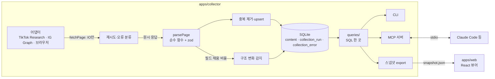
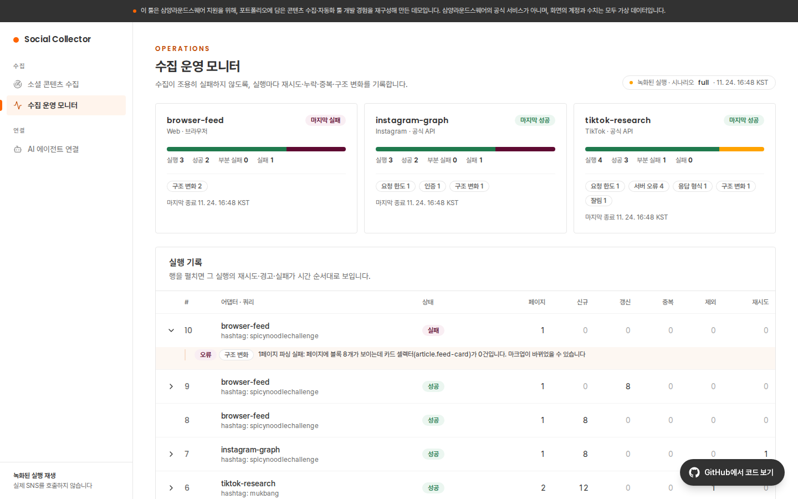
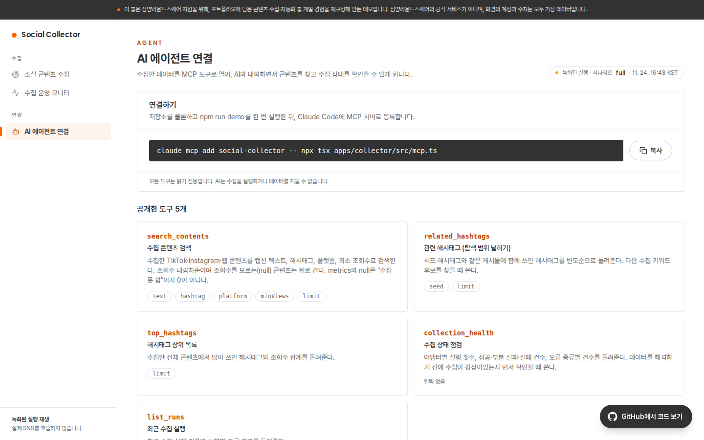

# Social Collector

**TikTok·Instagram에서 주제에 맞는 콘텐츠를 모으는 수집 에이전트입니다. 수집 실패·누락·중복·플랫폼 변화를 조용히 넘기지 않고 기록하며, 수집 결과는 MCP 도구로 AI가 직접 조회합니다.**

[](https://github.com/jjikkobro/marketing-tool-sy/actions/workflows/ci.yml)

> 삼양라운드스퀘어 **Popow – AI Agent Builder** 지원을 위한 개인 포트폴리오입니다. 삼양라운드스퀘어의 공식 서비스가 아니며, 데모의 계정·게시물·수치는 모두 가상입니다.

```bash
git clone https://github.com/jjikkobro/marketing-tool-sy && cd marketing-tool-sy
npm install
npm run demo:fail   # API 키 없이, 녹화한 응답으로 실패 상황 7가지를 재현합니다 (약 2초)
```

```
#  어댑터           쿼리                            상태       페이지  신규  갱신  중복  제외  재시도
1  tiktok-research  keyword:spicy noodle challenge  성공            2    14     0     2     0       0
2  instagram-graph  hashtag:spicynoodlechallenge    성공            2    11     0     0     0       0
3  tiktok-research  keyword:spicy noodle challenge  성공            2     0    14     0     0       0
4  tiktok-research  keyword:fire noodle             부분 실패       2    16     0     0     0       4
5  instagram-graph  hashtag:koreanramen             실패            0     0     0     0     0       0
6  tiktok-research  hashtag:mukbang                 성공            2    12     0     0     1       0
7  instagram-graph  hashtag:spicynoodlechallenge    성공            1     8     0     0     0       1
```

각 행이 보여주는 상황은 다음과 같습니다.

| # | 상황 | 결과 |
|---|---|---|
| 1 | 페이지 사이에 겹친 결과 | 중복 2건으로 세고 한 번만 저장 |
| 3 | 같은 쿼리 재실행 | 새 행 0, 갱신 14 (멱등성) |
| 4 | 429 응답 | Retry-After만큼 기다린 뒤 성공 |
| 4 | 503이 4번 연속 | 이미 받은 16건은 저장하고 부분 실패로 기록 |
| 5 | 토큰 만료 | 재시도하지 않고 즉시 실패 |
| 6 | 문서와 다른 필드명, ID 없는 항목, 페이지 상한 | 경고로 남김 |
| 7 | 좋아요 필드가 통째로 사라짐 | "채움 비율 91% → 0%" 경고 |

---

## 목차
1. [해결하려던 문제](#1-해결하려던-문제)
2. [동작 구조와 선택 이유](#2-동작-구조와-선택-이유)
3. [실제 실행에서 잘 된 점과 문제점](#3-실제-실행에서-잘-된-점과-문제점)
4. [해결 방법과 확인 방법](#4-해결-방법과-확인-방법)
5. [실행 방법](#5-실행-방법)
6. [수집 경계와 한계](#6-수집-경계와-한계)

---

## 1. 해결하려던 문제

이전 직장에서 마케팅 콘텐츠 자동화 툴을 직접 만들고 운영했습니다. 하는 일은 SNS 소재 수집, 게시물 성과 추적, 콘텐츠 생성이었습니다(Node.js, Express, Prisma, React). 운영하면서 가장 오래 남은 문제는 생성이 아니라 **수집이 조용히 틀리는 것**이었습니다.

- **미수집 값이 0으로 저장됨.** 공개 지표 수집기는 좋아요와 댓글을 받지 못해도 반응 합계를 `0`으로 계산했습니다. 그래서 데이터가 없던 게시물이 "반응이 없는 게시물"로 판정됐습니다.
- **식별자가 없는 항목이 하나로 합쳐짐.** 중복 판별 키의 두 번째 폴백이 항상 참이었습니다. 그래서 URL과 ID가 없는 서로 다른 글이 같은 해시가 되어 하나만 남았습니다.
- **같은 게시물이 두 번 저장됨.** Instagram의 `/p/X`와 `/reel/X`를 다른 콘텐츠로 셌습니다.
- **잘린 줄 모름.** 페이지 상한에 닿으면 남은 결과를 기록 없이 버렸습니다.
- **원인을 알 수 없음.** 수집기에 재시도가 없었고, 실패는 문자열 한 줄로만 남았습니다. 그래서 "왜 어제 데이터가 비었는지"를 매번 로그를 뒤져 추적했습니다.

이 저장소는 원본의 수집·추적 부분을 TypeScript로 다시 설계한 것입니다. 목표는 **수집이 실패했을 때, 무엇이 왜 얼마나 빠졌는지 데이터로 남게 하는 것**입니다. 위 세 가지 버그는 원본 동작을 재현하는 테스트와 수정 후 동작을 검증하는 테스트를 나란히 두었습니다([`legacy-regressions.test.ts`](apps/collector/test/legacy-regressions.test.ts)).

## 2. 동작 구조와 선택 이유



| 선택 | 이유 | 고려했지만 넣지 않은 것 |
|---|---|---|
| fetch와 parse를 분리했다 | 파싱을 순수 함수로 두면 녹화한 응답만으로 모든 분기를 테스트할 수 있다 | — |
| 중복 키를 `UNIQUE(platform, platform_content_id)`로 정했다 | URL 해시는 URL 형식이 바뀌면 깨진다(원본의 `/p`·`/reel` 문제) | 제목·본문 해시 폴백: 다른 글을 지울 수 있어 식별 불가 항목은 거부한다 |
| 실패를 행으로 남긴다 (`collection_error`) | 단계(fetch/parse/drift), 종류(429·인증·구조 변화…), HTTP 상태, 시도 횟수로 집계할 수 있어야 원인을 찾는다 | 원시 페이지 보관 테이블: 저장할 개인정보만 늘어난다 |
| 429·5xx는 재시도, 401은 즉시 실패 | 인증 오류는 재시도해도 쿼터만 쓴다. Retry-After를 우선하고 없으면 full-jitter 백오프 | — |
| 구조 변화는 필드 채움 비율로 감지 | 원본은 필드명이 바뀌면 조용히 null로 흡수했다. 직전 정상 실행 대비 "늘 채워지던 필드가 비었는지"를 본다 | 필드별 스키마 스냅샷 테이블: 비율 JSON 컬럼 하나로 충분하다 |
| 동시 실행은 부분 UNIQUE 인덱스로 막음 | `WHERE status='running'` 인덱스 하나로 같은 쿼리의 중복 실행을 DB가 막는다 | lease 락 테이블: 단일 프로세스 규모에서는 과설계다 |
| SQLite + 직접 쓴 SQL | 집계·동시출현 쿼리를 그대로 보이고 설명할 수 있다. 마이그레이션은 번호 붙은 `.sql` + `PRAGMA user_version` | Prisma(원본)·Drizzle: SQL이 가려지고 의존성이 늘어난다 |
| 워크스페이스 2개 (collector, web) | MCP·CLI·export는 같은 `queries/`를 쓰는 진입점 파일일 뿐이다. 웹은 서버 없이 스냅샷을 읽는다 | HTTP 서버와 공유 타입 패키지: collector의 `./schema` subpath export로 대체 |
| 탐색 범위 확장은 해시태그 동시출현 SQL로 | 결과를 설명할 수 있고 비용이 들지 않는다 | LLM 키워드 확장: v0.1에서는 근거를 설명하기 어렵다 |

### AI 코딩 에이전트의 제안을 어떻게 검토했는지

Claude Code로 개발했고, 방향을 정할 때는 **관점이 다른 AI 에이전트 4개(면접관·아키텍트·전략가·레드팀)에게 두 라운드 토론**을 시켰습니다. 결론은 제가 정했고, 제안마다 채택·수정·기각과 그 근거를 [결정 기록](docs/decisions/)에 남겼습니다. 기각한 예는 다음과 같습니다.

- **TikTok oEmbed로 7일간 실데이터 점검** (레드팀 제안). 공식 문서와 개발자 약관 원문을 직접 읽었습니다.
  - 응답에 제목·작성자 필드가 없어 "메타데이터 변화 감지"라는 전제가 성립하지 않았습니다.
  - 약관 III.3(h)가 콘텐츠에 대한 레코드 구축을 금지했습니다.
  - 기능 자체가 폐기 예정이었습니다.
  
  그래서 기각했습니다 ([0001](docs/decisions/0001-포트폴리오-범위.md)).
- **YouTube Data API로 실수집**. 대상 플랫폼이 아니라 오히려 공고를 읽지 않은 것처럼 보인다고 판단해 기각했습니다.
- **Drizzle 전환, lease 락, 원시 페이지 테이블**. 이 규모에서는 설명할 수 없는 복잡도라 기각했습니다.
- **"키만 넣으면 실서비스가 돈다"는 어댑터 구현**. 한 번도 실행해 보지 않은 코드를 "동작한다"고 쓸 수 없어 범위를 줄였습니다(§6).

AI가 쓴 코드도 그대로 두지 않았습니다. 실행 결과로 틀린 곳을 찾은 사례는 §3에 있습니다.

## 3. 실제 실행에서 잘 된 점과 문제점

**잘 된 점**
- `npm run demo:fail` 한 번으로 429 재시도 성공, 503 연속 후 부분 실패, 토큰 만료 즉시 실패, 필드명 변경, 페이지 상한, 필드 소실이 모두 실행 기록에 원인과 함께 남습니다.
- 같은 쿼리를 다시 돌리면 새 행 0, 갱신 14로 끝납니다(멱등성).
- 실제 Chromium으로 가상 피드를 수집하면 두 가지 마크업 변화를 구분해서 기록합니다.
  - v2(클래스 이름 변경): "수집은 성공했지만 조회수 채움 비율 100% → 0%"
  - v3(구조 개편): "블록 8개가 보이는데 셀렉터 0건"
- MCP 서버를 실제 클라이언트로 연결해 도구 5개 목록 조회와 호출 결과를 확인했습니다.

**실행하고서야 드러난 문제** (모두 고쳤고 회귀 테스트가 있습니다. 자세한 내용은 [0002](docs/decisions/0002-실행에서-발견한-문제.md))

| 문제 | 어떻게 드러났나 | 원인 |
|---|---|---|
| 좋아요를 숨긴 Instagram 게시물이 **통째로 버려짐** | 데모 #2에서 1건, #7에서 8건 전부가 "형식 오류"로 제외됨. 그래서 #7의 필드 소실 감지도 동작하지 않음 | zod v4에서 객체 안의 `z.unknown()`은 키가 없으면 실패한다. "0 대신 null" 버그를 고치다 "아예 버리는" 더 나쁜 버그를 만들었다 |
| TikTok 영상 ID가 **다른 값으로 바뀜** | 공식 문서 예시의 ID(`702874395068494965`)가 2^53을 넘는다는 걸 확인하고 재현함 | `JSON.parse`가 int64를 double로 바꾼다. 서로 다른 영상이 같은 키로 합쳐질 수 있다. 파싱 전에 ID 필드를 문자열로 감싼다 |
| 어댑터별 **오류 집계가 틀림** | 쿼리를 다시 읽다가 발견 | `json_group_object`에 같은 키가 여러 번 들어가 마지막 값만 남았다. SQL에서 먼저 합산하도록 바꿨다 |
| 브라우저 수집이 **전부 실패** | 브라우저 데모 첫 실행에서 `__name is not defined` | tsx(esbuild)가 넣는 함수 이름 헬퍼가 `page.evaluate`로 직렬화된 코드에는 없다. 이 실패도 숨지 않고 실행 기록에 남았다 |
| 예상 못 한 예외가 나면 **다음 실행이 영구히 막힘** | 코드 리뷰에서 발견 | 실행이 `running`으로 남으면 부분 UNIQUE 인덱스가 다음 실행을 막는다. 예외가 나도 `failed`로 마감한다 |

공식 문서끼리 어긋나는 곳도 있었습니다. TikTok Research API는 필드 표에 `id`, 응답 예시에 `video_id`라고 적혀 있습니다. 파서는 둘 다 받고, `video_id`가 오면 구조 변화 경고를 남깁니다.

## 4. 해결 방법과 확인 방법

| 확인 | 명령 | 내용 |
|---|---|---|
| 단위·통합 테스트 40개 | `npm test` | 원본 버그 3건 회귀, 재시도·오류 분류, 어댑터 파싱(int64·필드명·숨긴 좋아요), 파이프라인(멱등·부분 실패·잘림·동시 실행·구조 변화), 실제 Chromium 수집 |
| 테스트가 버그를 잡는지 | 고친 코드를 되돌려 실행 | zod optional, int64 보존, `/reel` 정규화를 되돌리면 13개가 실패하는 것을 확인했다 |
| 데모 재현 | `npm run demo:fail` | 위 표의 실행 기록이 그대로 나온다 |
| 공개 안전 | `npm run check:leaks` | 이전 직장 명칭이 저장소에 들어가지 않았는지 해시로 검사한다 |
| CI | GitHub Actions | 위 항목과 타입 검사, 린트, 포맷, 빌드를 push마다 실행한다 |

픽스처는 직접 지어내지 않았습니다. 응답 구조를 [TikTok Research API](https://developers.tiktok.com/doc/research-api-specs-query-videos)와 [Instagram Graph API](https://developers.facebook.com/docs/instagram-platform/instagram-graph-api/reference/ig-hashtag/recent-media) 문서 예시에서 가져왔고, 값만 가상으로 채웠습니다([`fixtures.ts`](apps/collector/src/demo/fixtures.ts)). 내가 만든 데이터를 내 파서가 통과시키는 순환 검증을 피하기 위해서입니다.

## 5. 실행 방법

Node 22 이상이 필요합니다.

```bash
npm install
npm run demo            # 정상 수집 3회
npm run demo:fail       # 실패 시나리오 포함 7회
npm run demo:browser    # 실제 Chromium으로 가상 피드 v1→v2→v3 (npx playwright install chromium 필요)

npm run cli -w @studio/collector -- related spicynoodlechallenge   # 함께 쓰인 해시태그로 탐색 범위 넓히기
npm run cli -w @studio/collector -- errors                         # 오류·경고 기록

npm run dev             # 웹 화면 (apps/web/public/data/snapshot.json 재생)
npm run snapshot        # 웹 화면용 스냅샷 다시 만들기
```

**MCP로 AI와 연결하기** (데모를 한 번 실행한 뒤)

```bash
claude mcp add social-collector -- npx tsx apps/collector/src/mcp.ts
```

도구는 `search_contents`, `related_hashtags`, `top_hashtags`, `collection_health`, `list_runs`의 5개이고 모두 읽기 전용입니다.

| 소셜 콘텐츠 수집 | 수집 운영 모니터 | AI 에이전트 연결 |
|---|---|---|
|  |  |  |

## 6. 수집 경계와 한계

**하지 않는 것**
- 로그인이 필요한 페이지 수집
- 차단 우회 (원본에 있던 stealth 플러그인은 옮기지 않았습니다)
- 실제 SNS 사이트 스크래핑 (브라우저 자동화는 저장소 안의 가상 피드만 대상으로 합니다)

**저장하는 것**: 콘텐츠 식별자, 캡션, 해시태그, 공개 지표, 크리에이터 핸들(TikTok만. Instagram API는 username을 주지 않습니다)

**한계**
- 실서비스 호출은 검증하지 않았습니다. 어댑터의 요청 형식은 공식 문서를 따랐지만, 실제 토큰으로 호출해 본 적은 없습니다. 모든 데모는 녹화한 응답으로 돕니다.
- TikTok Research API는 승인된 연구 목적에만 열려 있어 개인이 실제 키를 받기 어렵습니다. 하루 1,000회 요청 제한도 있습니다.
- Instagram 해시태그 조회는 7일 동안 고유 해시태그 30개, 최근 24시간 게시물로 제한됩니다. 수집 대상 키워드가 많아지면 가장 먼저 이 제한에 걸립니다.
- 구조 변화 감지는 필드 채움 비율만 봅니다. 값의 의미가 바뀌는 경우(예: 조회수 단위 변경)는 잡지 못합니다.

**다음 단계**
- 본인 계정으로 Instagram Graph API(Business Discovery)를 실제 호출해 검증하기
- 수집 건강 리포트를 만드는 읽기 전용 Python 분석(`analysis/`)

---

<sub>디자인 톤은 삼양라운드스퀘어 CI의 컬러 규정(Evolving Orange #FF6400, Sophisto Charcoal #323232 등)과 서체(Pretendard, Poppins)만 참고했으며, CI 심볼과 로고는 사용하지 않았습니다. 접근성 대비 때문에 흰 배경 위 오렌지 글자는 #C24A00을 씁니다.</sub>
